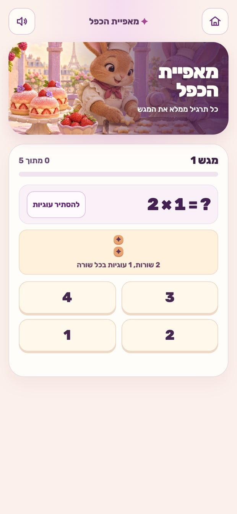
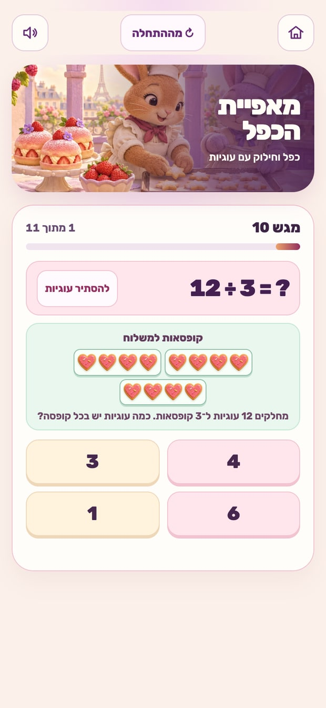
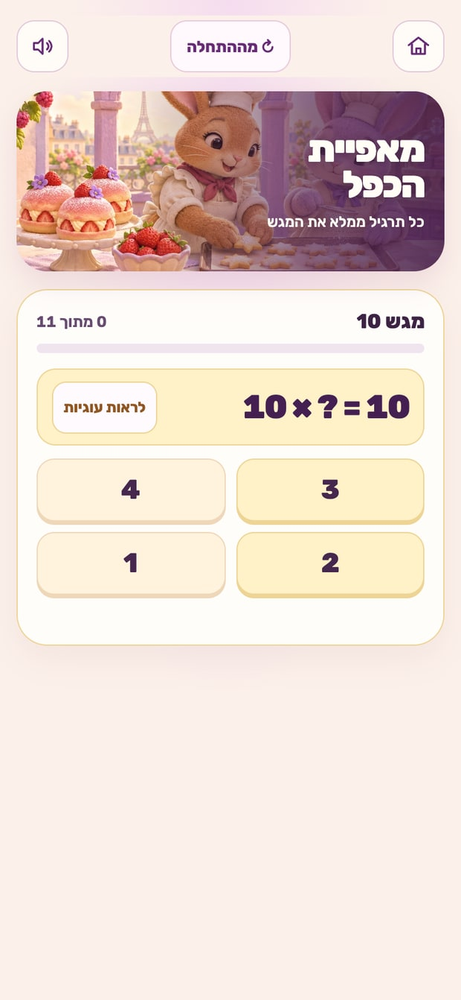
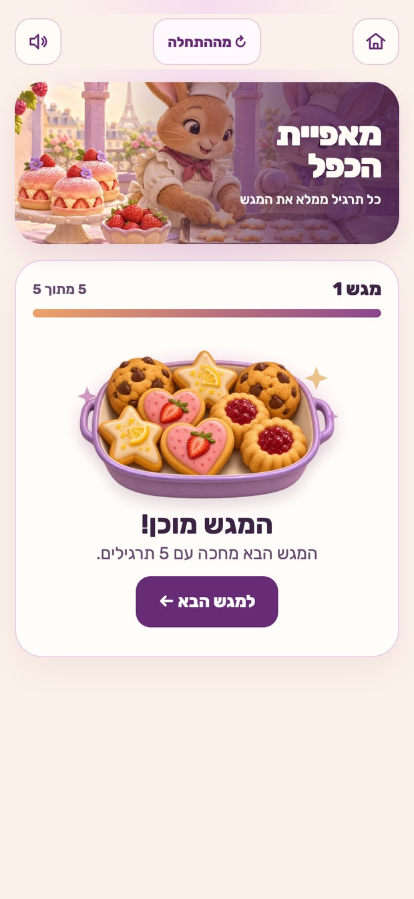

# מאפיית הכפל

משחק מגע ללימוד ותרגול לוח הכפל עד 10×10. כל תשובה נכונה ממלאת מקום במגש ומקדמת לתרגיל הבא.

**[לפתוח ולשחק](https://amitshe.github.io/multiplication-bakery/)** · **[מגרש המשחקים](https://amitshe.github.io/)**

## איך משחקים

1. בוחרים את התשובה הנכונה מתוך ארבע אפשרויות.
2. פותחים את **לראות עוגיות** כדי לראות את הכפל בעוגיות מאוירות. העזרה מתחלפת בין שורות במגש, קופסאות ומדפי ויטרינה. במגשים הראשונים ההמחשה כבר פתוחה.
3. אם טעיתם, בוחרים תשובה אחרת באותו תרגיל. תרגילים שקשה בהם מקבלים סיכוי גבוה יותר לחזור.
4. כשהמגש מלא, מופיע מגש עוגיות מונפש. מקישים על **למגש הבא** וממשיכים ללוחות נוספים, תרגילים עם גורם חסר ומגשים עם יותר תרגילים. אפשר להמשיך לעוד מגשים בלי שלב סיום.

אחרי שכל לוחות הכפל נפתחים, כל מגש מוסיף תרגיל. המשחק שומר את ההתקדמות בתוך המגש, את התרגילים שדורשים חזרה ואת העדפת הצליל בדפדפן. המשחק עובד באצבע אחת ואינו דורש חשבון.

הכפתור **מההתחלה** בראש המסך מחזיר למגש הראשון לאחר אישור. אפשר להשתיק את צלילי העוגיות והמאפייה בכפתור הרמקול.

## צילומי מסך

<p align="center">
  
  
  
  
</p>

## הוספה למסך הבית

באייפון פותחים ב־Safari ובוחרים **שיתוף ← הוספה למסך הבית**. באנדרואיד פותחים ב־Chrome ובוחרים **הוספה למסך הבית** או **התקנה** מתפריט הדפדפן. למשחק יש אייקון ייחודי.

## הפעלה מקומית

מתוך הריפו מריצים:

```sh
python3 -m http.server 8000
```

פותחים את http://localhost:8000/. אין התקנת חבילות או שלב בנייה.

- `facts.js` בוחר תרגילים, גורמים חסרים, תשובות ומספר תרגילים במגש.
- `game.js` מציג את המשחק, מגיב להקשות ושומר התקדמות.
- `sound.js` מנגן משוב קולי באמצעות Web Audio.
- `assets/` כולל איורי מאפייה ועוגיות שנוצרו ב־ImageGen, אייקונים וגופני Rubik. רישיון הגופן מצורף.

## פרסום

GitHub Pages מגיש את הקבצים משורש הענף `main` בנתיב `/multiplication-bakery/`. הקובץ `.nojekyll` מאפשר הגשה ישירה של הקבצים.
